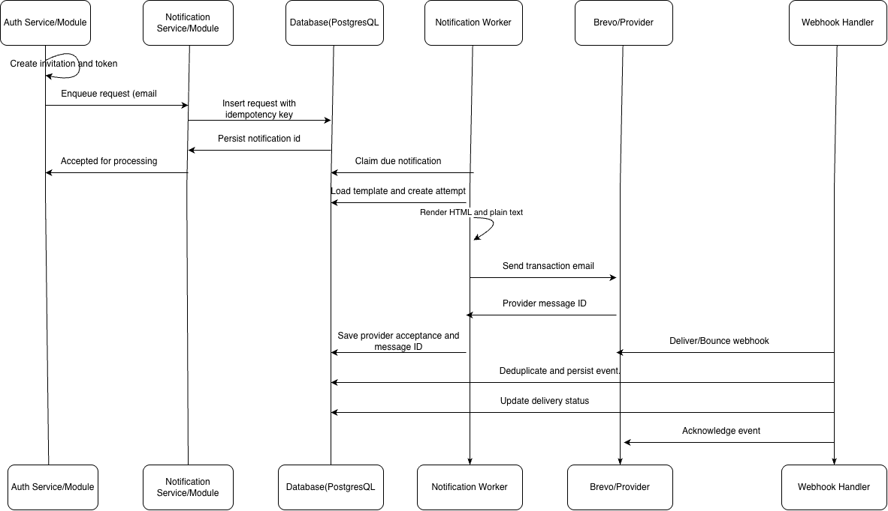
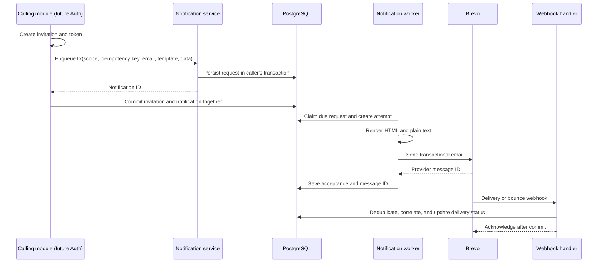

# Notification Architecture

Notification is the shared delivery capability used by OshePayment's business
modules. It is implemented first because all other business modules depend on
it, while it depends on none of them. [ADR-004](../adr/004_build-notification-first.md)
records that implementation order; [ADR-005](../adr/005_notification-email-delivery.md)
records the email delivery decisions.

The first version supports email through Brevo, with local versioned templates
and one shared OshePayment sender. Its first use case is invitation email for
the future Auth module in the invite-only, multitenant platform.

## Original design diagram

The following is the original diagram used to guide the implementation. Auth
is shown as a future caller; Notification does not implement Auth itself.

[Open or download the original diagram](diagrams/notification.drawio.png).
The PNG retains its embedded diagrams.net source and can be opened in
Draw.io/diagrams.net for editing. Its transparent background is best viewed
against a light background.

## Components and ownership

| Component | Responsibility |
| --- | --- |
| Calling business module | Authorize scope and recipient, create domain records, and request a notification. Auth owns invitation tokens, expiry, revocation, and redemption. |
| Notification service | Validate requests, enforce scoped idempotency, persist email requests, and return a notification ID. |
| PostgreSQL store | Own the durable queue, attempts, delivery events, and worker coordination in the `notification` schema. |
| Notification worker | Claim due requests, create attempts, render HTML and plain text, send through the provider adapter, and save the result. |
| Brevo adapter | Submit transactional email, supply correlation and idempotency headers, and classify provider outcomes. |
| Webhook handler | Authenticate callbacks, deduplicate and correlate events, persist delivery results, and acknowledge committed events. |

These components belong to the modular monolith's codebase. The API exposes the
webhook handler, while `cmd/notification-worker` runs the worker separately.
PostgreSQL provides queue durability without a message broker. The module does
not expose a public enqueue or status HTTP API; trusted internal callers use
its Go service contract.

## Request and delivery flow

The caller uses `EnqueueTx` to commit its business record and notification
request atomically. A returned ID is durable only after the caller commits.
`Enqueue` is available when there is no related business write. Repeating the
same request under the same scoped idempotency key returns the existing ID;
a different payload under that key returns `ErrConflict`.

The worker claims a due request using `FOR UPDATE SKIP LOCKED`, increments its
attempt count, and records the attempt in a short transaction. It commits before
rendering and contacting Brevo, so external I/O never holds database locks.
Additional worker processes can claim other requests concurrently.

The initial `invitation.v1` template renders HTML with escaped display values
and renders plain text separately. Auth supplies the HTTPS invitation URL and
expiry; Notification derives the displayed expiry from that value and skips
requests already expired when claimed.

## Multitenant boundaries

Every request explicitly selects platform scope or tenant scope. Platform scope
supports invitations issued before a tenant exists. Tenant scope requires an
explicit tenant identifier. A missing tenant never defaults to platform scope,
and platform scope does not grant access to tenant notifications.

Idempotency is unique by `(scope, tenant_id, idempotency_key)`. Status reads
require the same scope and tenant as the stored request. Calling modules remain
responsible for authorizing the scope and recipient; Notification does not
query Auth or tenant-domain tables.

Webhook payloads cannot select a tenant. Ownership comes from a stored attempt
matched by provider message ID or the opaque attempt ID sent in the custom
header, with a recipient check. Attempts and events inherit ownership through
their notification relationship.

## Persistence and state

| Table | Stored information |
| --- | --- |
| `notification.messages` | Scope, tenant, idempotency key and request hash, recipient, template data, expiry, submission and delivery states, scheduling, and claim lease. |
| `notification.attempts` | Each send attempt, its outcome, normalized provider message ID, safe error code, and timestamps. |
| `notification.events` | Deduplicated normalized provider events and their attempt correlation; unmatched events remain available for reconciliation. |

Submission state is separate from delivery state. `accepted` means Brevo
accepted the request; it does not establish inbox delivery.

| Condition | Submission behavior |
| --- | --- |
| New request | `queued`, then `processing` when claimed. |
| Provider acceptance | `accepted`; delivery remains `pending` until an applicable event arrives. |
| HTTP 429 rate limit | Schedule another attempt with exponential delay and Retry-After support, up to five attempts. |
| Permanent rejection or invalid template | `failed`. |
| Transport error, HTTP 408/5xx, or malformed acceptance | `unknown`; no automatic resend. |
| Abandoned one-minute worker lease | `unknown`; no automatic resend. |
| Expired request at claim time | `expired`; no email sent. |

Unknown outcomes avoid blindly duplicating an invitation whose provider
acceptance is uncertain. A correlated webhook can resolve them; otherwise they
require operational investigation. Provider-side idempotency is an additional
defense, not an exactly-once delivery guarantee.

## Webhook reconciliation

`POST /webhooks/brevo` authenticates a configured bearer token and acknowledges
supported events only after persistence succeeds. Deduplication uses message ID,
recipient, event kind, and event timestamp. Brevo's webhook configuration `id`
is not used as a unique event identifier.

Callbacks can arrive before the worker saves the send response. Custom attempt
correlation handles that race directly. Unmatched events can also be linked
when provider acceptance is saved, and the worker periodically reconciles
remaining matchable events.

Delivery status advances by severity: complaint, permanent failure, delivery,
then deferral. Within one severity, newer timestamps win. This prevents late
sent or deferral events from erasing a delivery or bounce. Delivery callbacks do
not create invitations, redeem tokens, or grant access.

## Security and operational boundaries

Notification logs omit email contents, invitation URLs, credentials, and raw
provider bodies. Stored webhook events contain normalized metadata rather than
raw payloads. Queued recipients and invitation URLs remain sensitive database
data and require restricted access, protected backups, and a retention policy.
Automatic retention and an operations UI are not implemented in this version.

Notification is disabled by default. The API registers its webhook route only
when enabled, and the worker requires explicit configuration. SMS, tenant-specific
senders, hosted provider templates, and Auth implementation are outside this
version's scope.

See the [Notification module guide](../modules/notification.md) for configuration,
calling examples, recovery details, and test commands. Implementation lives in
[`internal/notification`](../../internal/notification/), with schema changes in
[`00002_notification.sql`](../../internal/platform/postgres/migrations/00002_notification.sql).
