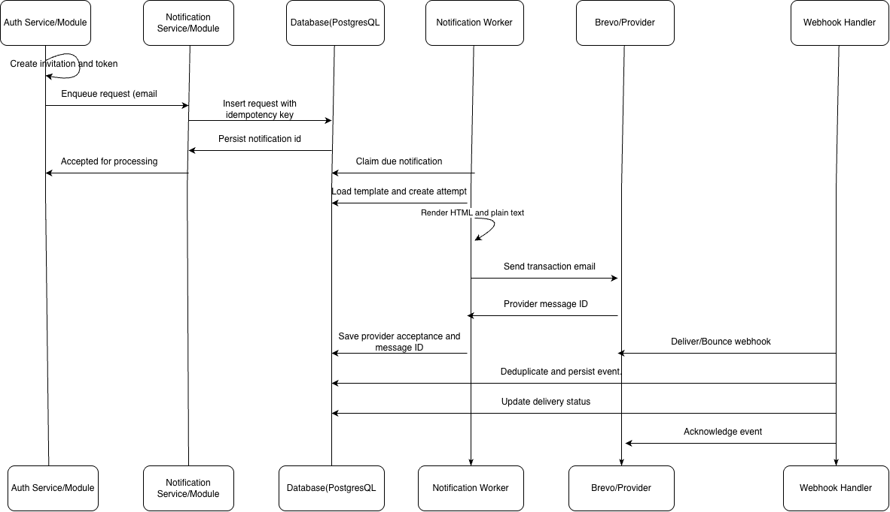

# Notification Module

Notification provides durable email delivery for trusted internal callers. It
has no dependency on Auth or tenant-domain implementations. See
[ADR-004](../adr/004_build-notification-first.md) for implementation order and
[ADR-005](../adr/005_notification-email-delivery.md) for the delivery decisions.

## Architecture

The original diagram used to guide the Notification module design:



[Open the original Draw.io diagram](../architecture/diagrams/notification.drawio.png).

See [Notification Architecture](../architecture/notification.md) for the module
boundaries, original design diagram, delivery flow, tenant isolation, and
failure handling.

## Running

Apply migrations separately, then configure the API and worker using the same
settings from `.env.example`:

```sh
go run ./cmd/migrate up
# Set NOTIFICATION_ENABLED=true, BREVO_API_KEY, NOTIFICATION_SENDER_EMAIL,
# NOTIFICATION_SENDER_NAME, and BREVO_WEBHOOK_TOKEN in the process environment.
go run ./cmd/api
# In a separate terminal with the same environment:
go run ./cmd/notification-worker
```

The sender email/domain must be verified with Brevo. Configure a **transactional
email** webhook to the API's HTTPS `POST /webhooks/brevo` endpoint, with bearer
authentication matching `BREVO_WEBHOOK_TOKEN` (a random secret of at least 32
characters). Subscribe to sent/request, delivered, deferred, soft bounce, hard
bounce, invalid email, blocked, error, and spam events. Brevo's subscription
labels can use camelCase while payloads use names such as `hard_bounce`.

Notification is disabled by default; the API does not register the webhook route
when disabled, and the worker refuses to start. No public application enqueue or status API
is exposed before application authorization exists. The opt-in manual testing
routes described below use a separate privileged token. Configure runtime database
roles with schema USAGE and SELECT/INSERT/UPDATE on Notification tables separately
from the migration-owner role.

## Calling contract

Construct `notification.NewService(notification.NewStore(pool))` in the
composition root and inject it into calling modules. Use `EnqueueTx` for a
transaction that also creates an invitation; use `Enqueue` when there is no
related business write.

```go
// Auth must authorize this scope and recipient before calling Notification.
request := notification.Request{
    Scope:          notification.TenantScope(tenantID),
    IdempotencyKey: "invitation:" + invitationID,
    Recipient:      inviteeEmail,
    Template:       notification.InvitationTemplate, // invitation.v1
    ExpiresAt:      invitationExpiresAt,
    Data: map[string]string{
        "name":           inviteeName,
        "inviter":        inviterName,
        "organization":   organizationName,
        "invitation_url": invitationURL, // HTTPS; token owned by Auth
    },
}
receipt, err := notifications.EnqueueTx(ctx, tx, request)
// Commit tx before considering the invitation and notification durable.
```

For an invitation issued before tenant creation, explicitly use
`notification.PlatformScope()`. A missing tenant ID never implies platform
scope. Tenant IDs are opaque identifiers (1–128 characters); future tenant
modules own their validity and authorization. All user-supplied display strings
are escaped in HTML; plaintext is rendered independently. Notification derives
the displayed expiry from `ExpiresAt`.

Repeat an identical request, including the original expiry, to get the same
notification ID. A changed request under the same scoped key returns
`ErrConflict`. `Get(ctx, scope, notificationID)` returns only ID, submission
status, and delivery status, and returns `ErrNotFound` for another tenant's ID.
Scope checks are enforced by the module's queries; calling modules must not
expose raw storage access or accept arbitrary scopes from untrusted users.

## Delivery and recovery

Submission statuses are `queued`, `processing`, `accepted`, `failed`, `unknown`,
and `expired`. Delivery status starts as `pending` and may become `deferred`,
`delivered`, `bounced`, `blocked`, or `complained`. API acceptance does not mean
the message reached an inbox.

A worker sends one email at a time. Additional processes provide concurrency.
Claims have a one-minute lease; sends time out after 15 seconds. An abandoned
lease becomes `unknown`. Requests already expired when claimed are marked
`expired` without sending. Auth must still enforce expiry on redemption.

Brevo HTTP 429 responses receive exponential delays, honoring Retry-After up to
one hour, with a maximum of five attempts. Transport errors, HTTP 408/5xx, and
malformed acceptance responses remain `unknown`; other rejections fail without
automatic retry. A verified webhook can resolve an unknown attempt later.
Operators should investigate unknown requests using attempt IDs and Brevo logs;
there is no automatic resend or unauthenticated replay endpoint.

Webhook delivery states advance by severity: complaint, permanent failure,
delivery, then deferral. Within a severity, newer timestamps win. Thus a late
sent/deferral event cannot erase a delivery, and an open event cannot clear a
bounce. Unsupported tracking events are acknowledged without storing them.
Unknown message IDs are persisted for later correlation, never assigned a tenant
based on incoming data. The worker periodically reconciles matchable events.

Queue data contains recipient PII and invitation URLs. Restrict database and
backup access, use production TLS, and apply a retention policy that removes
terminal message data and old events after the required operational window.
Do not remove queued/processing payloads or idempotency records while callers
may still retry. No email contents, URLs, API keys, or raw provider bodies are
logged. This version does not implement automatic retention or an operations UI.

## Verification

Unit tests use a fake HTTP transport and send no real email:

```sh
go test ./...
go vet ./...
```

Use separate **disposable** databases for the two integration suites; platform
tests exercise migration rollback while notification tests exercise concurrent
claims, scope isolation, transactional enqueue, retries, expiry, and webhook
ordering:

```sh
TEST_DATABASE_URL='postgres://.../platform_test' \
NOTIFICATION_TEST_DATABASE_URL='postgres://.../notification_test' \
go test -race ./...
```

## Manual testing with Swagger UI

Open `http://localhost:8080/docs` after starting the API. The checked-in OpenAPI
contract is served at `/openapi.yaml`. Swagger UI needs internet access to load
its pinned CDN assets.

To test enqueue and status operations, set `NOTIFICATION_ENABLED=true`, supply
all Brevo settings above, and set `NOTIFICATION_TEST_API_ENABLED=true` with a
separate random `NOTIFICATION_TEST_API_TOKEN` of at least 32 characters. For
example, generate the token with `openssl rand -hex 32`. Restart the API after
changing its environment. Keep these privileged test routes disabled in
production: their token authorizes arbitrary scopes and recipients.

1. Apply migrations and start both the API and notification worker as above.
2. In Swagger UI, click **Authorize** and enter the test token under **TestToken**
   (enter just the token; Swagger adds `Bearer`).
3. Expand `POST /testing/notifications` and choose **Try it out**. Replace the
   example recipient with your own test email and set a future `expires_at`.
   The example URL is a placeholder; it does not create an Auth invitation.
4. Execute the request and copy the returned `id`. A 202 means queued, not sent.
5. Execute `GET /testing/notifications/{id}` using that ID and the same `scope`
   and `tenant_id`. The worker moves submission status toward `accepted`.
6. Configure Brevo's real webhook (using **BrevoToken**, a different token) to
   observe `delivery_status`. For a manual webhook test, use the real provider
   message ID from the corresponding database attempt or Brevo logs and the
   same recipient; arbitrary IDs will not update the receipt. Simulated events
   test reconciliation, not actual inbox delivery.

Reusing the exact request returns the same ID. Change the idempotency key for a
new email; reuse of a key with changed content returns 409. Without the opt-in
flag the testing routes return 404. No credentials are embedded in the spec or
persisted by Swagger UI.
